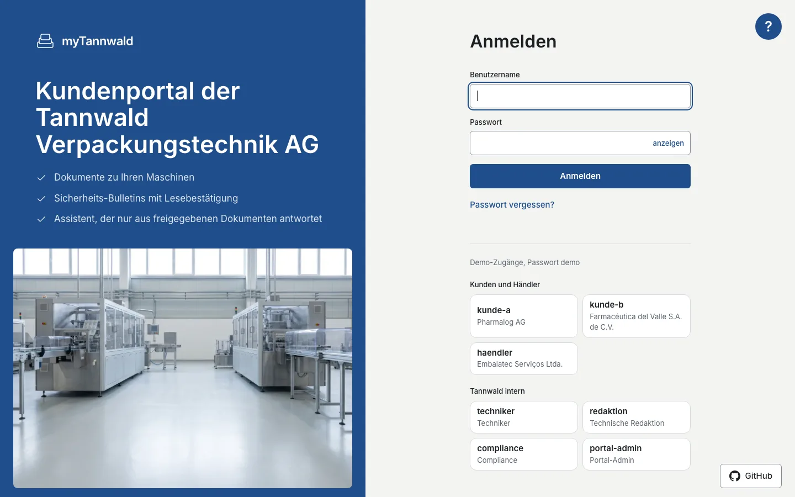
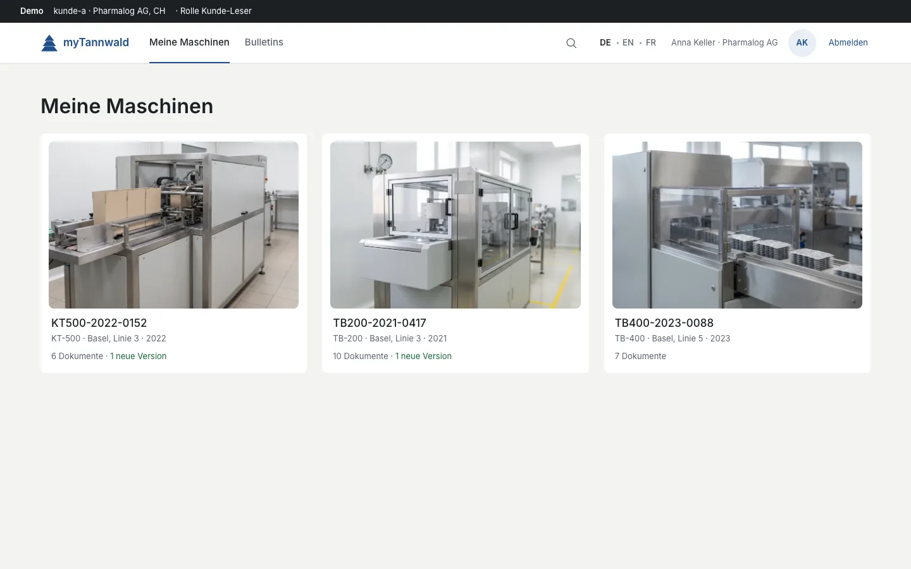
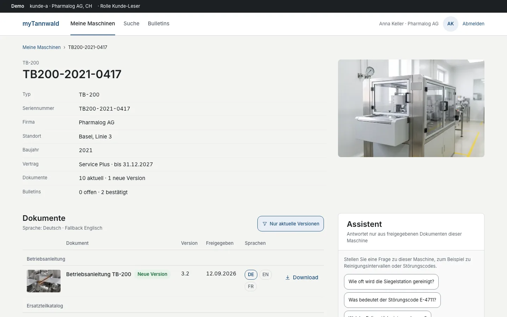
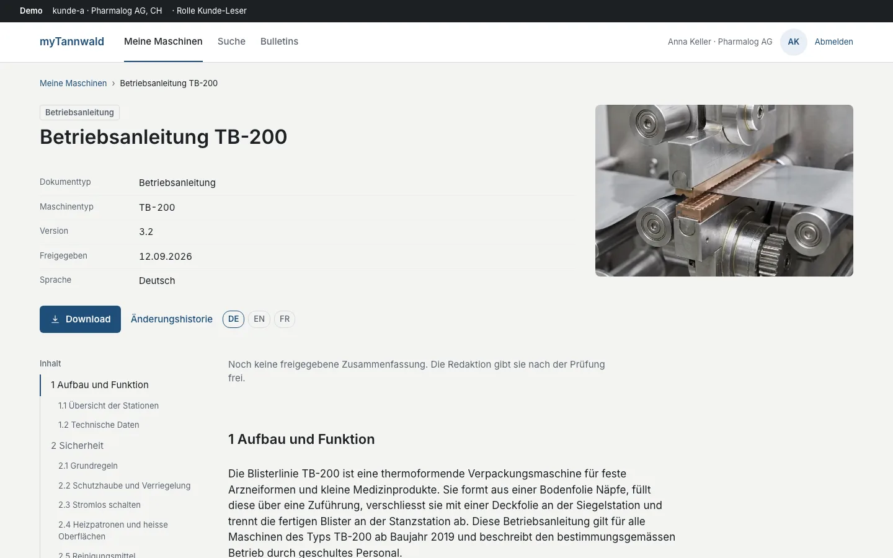
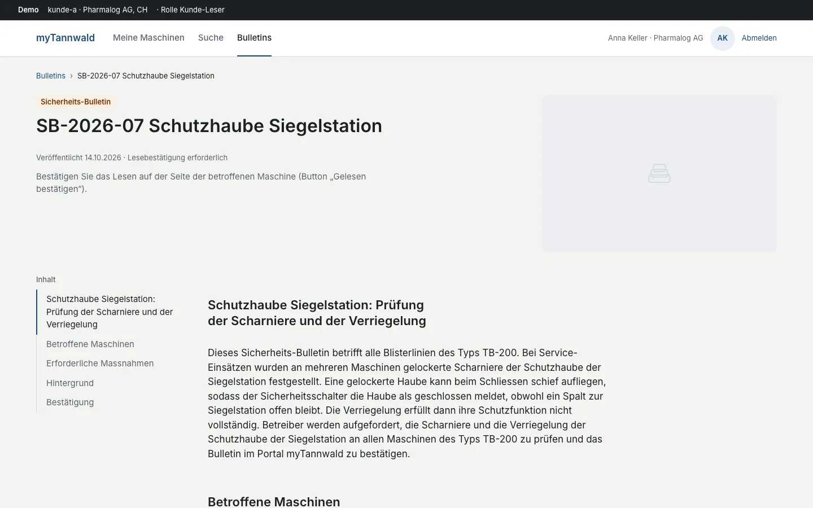
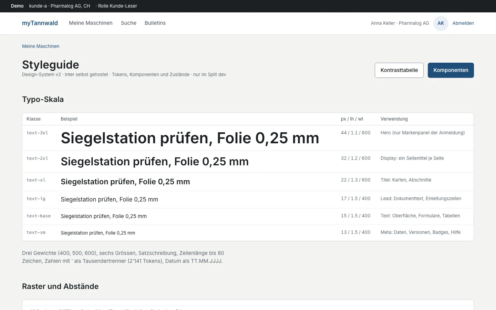
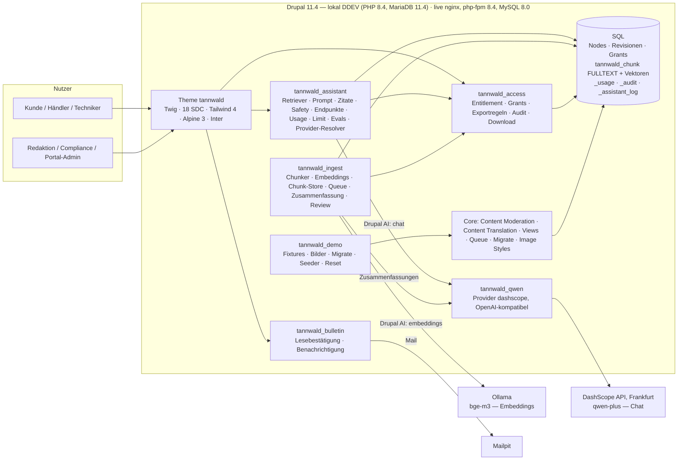

# myTannwald — Kundenportal mit rechtebewusster Suche und zitierendem Assistenten

**Ein Proof of Concept auf Drupal 11, in 48 Stunden gebaut und in einer zweiten Phase live gestellt: Dokumente je
Maschine hinter dem Login, hybride Suche, ein Assistent, der nur aus freigegebenen und berechtigten Dokumenten
antwortet, und ein redaktioneller Freigabe-Workflow — gemessen mit Tests und Evals.**

**Live:** [https://mytannwald.getleaven.com](https://mytannwald.getleaven.com) — Demo-Konten auf der Anmeldeseite,
Passwort `demo`. Siehe [Live-Demo](#live-demo).


> Fiktiver Kunde. Die Tannwald Verpackungstechnik AG, ihre Kunden, Personen, Maschinen und Dokumente sind erfunden;
> Ähnlichkeiten mit realen Unternehmen sind zufällig. Reale Produktnamen (Drupal, DDEV, Ollama, Qwen, SAP, Azure …)
> bezeichnen nur den Systemtyp.

## English summary

myTannwald is a proof of concept for a customer portal of a fictional Swiss packaging-machine manufacturer, built in
48 hours on Drupal 11 and taken live in a second phase. Every customer sees exactly the documents for the machines
in their fleet, with versions, languages and export-control classes enforced by one entitlement service that feeds
node access, the search index and the assistant alike. Search is hybrid (SQL full text plus `bge-m3` vectors, fused
by reciprocal rank fusion); the assistant (`qwen-plus` via the DashScope API in Frankfurt, embeddings `bge-m3` via
Ollama) answers only from released, permitted chunks and every citation is validated against the retrieved context.
AI summaries pass a human review workflow before they become searchable; safety questions never get a shortened
answer. Rights, retrieval and refusal behaviour are covered by 291 automated tests and an 80-question evaluation set
with before/after figures. One script brings a fresh Mac to the demo state; the same script deploys to a plain
nginx/php-fpm server. The live demo is open: [mytannwald.getleaven.com](https://mytannwald.getleaven.com), demo
accounts on the login page, password `demo`.

## Inhalt

1. [Live-Demo](#live-demo)
2. [Ausgangslage](#ausgangslage)
3. [Was der PoC beweist — fünf Demo-Momente](#was-der-poc-beweist--fünf-demo-momente)
4. [Design](#design)
5. [Architektur](#architektur)
6. [Assistent mit Qwen über API](#assistent-mit-qwen-über-api)
7. [Kennzahlen](#kennzahlen)
8. [Betrieb](#betrieb)
9. [Installation](#installation)
10. [Bilder](#bilder)
11. [Grenzen](#grenzen)
12. [Ausbau Phase 1](#ausbau-phase-1)
13. [Änderungsverlauf Phase 2](#änderungsverlauf-phase-2)
14. [Lizenz](#lizenz)

## Live-Demo

Die Demo läuft unter **[https://mytannwald.getleaven.com](https://mytannwald.getleaven.com)**. Die Site ist offen
(kein Besucher-Passwort); die Anmeldeseite zeigt sieben Demo-Konten als Chips, Passwort für alle `demo`. Ein „?“ auf
der Anmeldeseite erklärt, was die Demo ist, ein Button führt zu diesem Repo. Suchmaschinen bleiben draussen
(`robots.txt` und `X-Robots-Tag: noindex`). Das Postfach der Demo (Mailpit, jede Mail der Site landet dort) ist nur für
den Betreiber erreichbar; wer die Mails sehen will, fragt ihn. Was Sie in der Demo ändern (Lesebestätigung, Freigabe,
Support-Anfrage), bleibt, bis der Betreiber die Demo-Daten zurücksetzt.

**Fünf Minuten, ein Weg:**

1. **Anmelden** als `kunde-a` (Chip anklicken, Passwort `demo`).
2. **Meine Maschinen:** drei Karten mit Typbild, Seriennummer, Standort, Dokumenten und offenen Bulletins.
3. **Maschine TB200-2021-0417:** Typenschild, Seriennummernbild, das offene Sicherheits-Bulletin als Hinweis,
   Dokumente nach Typ mit Versionen, Sprachen und Badges („Nur Pharmalog AG“, „Dual-Use · Exportklasse 2“).
4. **Dokument** Betriebsanleitung TB-200: Download, Änderungshistorie, Inhaltsverzeichnis, freigegebene Zusammenfassung.
5. **Suche** (Lupe in der Kopfzeile): „Folie reisst beim Siegeln“ findet Kapitel 9.4 nur im Modus Hybrid;
   „E-4711“ trifft die Störungstabelle in beiden Modi; Facetten zählen nur, was das Konto sehen darf.
6. **Assistent** (auf der Maschinenseite oder neben der Suche): „Wie oft muss die Siegelstation gereinigt werden?“ —
   Antwort mit Zitaten `[n]` ins Kapitel, 1–8 s über die API. „Schutzhaube überbrücken?“ bekommt die
   Sicherheitsvorlage ohne Modellaufruf. „Lieferzeit von Teil 4711?“ wird abgelehnt, mit „Support-Anfrage erstellen“.
7. **Redaktion:** abmelden, als `redaktion` anmelden, „Freigaben“ — Zusammenfassungen im Status „Zur Prüfung“,
   Freigeben, Entwurf speichern, Zurückweisen; „Unbeantwortete Fragen“ zeigt, wo Dokumentation fehlt.

**Demo-Konten** (Passwort `demo`; Kontowechsel über Abmelden und den nächsten Chip):

| Konto | Person | Firma, Land | Rolle | Sieht |
|---|---|---|---|---|
| `kunde-a` | Anna Keller | Pharmalog AG, CH | Kunde | TB-200, TB-400, KT-500; Anlagendokumentation TB200-2021-0417; Exportklassen 1 und 2 |
| `kunde-b` | Elena Vargas | Farmacéutica del Valle, MX | Kunde | TB-400, KT-500; keine Schaltpläne (MX ohne Exportfreigabe) |
| `haendler` | Rafael Monteiro | Embalatec Serviços, BR | Händler | Typen der Kunden im Gebiet BR/MX/AR/CL; Exportklasse 1, nicht 2 |
| `techniker` | Marco Steiner | Tannwald, CH | Techniker | alles, inklusive Änderungshistorie |
| `redaktion` | Lea Brunner | Tannwald, CH | Technische Redaktion | alles; Freigaben, Unbeantwortete Fragen, Bulletins |
| `compliance` | Nadine Frei | Tannwald, CH | Compliance | alles; Exportregeln, Audit-Log, zweites Augenpaar bei Freigaben |
| `portal-admin` | Jonas Widmer | Tannwald, CH | Portal-Admin | alles; Nutzung und Kosten, Einstellungen des Assistenten |

Oberfläche in Deutsch, Englisch und Französisch (Sprachwechsler in der Kopfzeile); Dokumente liegen in bis zu drei
Sprachen vor, mit Fallback-Hinweis.

## Ausgangslage

Die fiktive Tannwald Verpackungstechnik AG (Langenthal, 1'150 Mitarbeitende, 9'500 installierte Maschinen in 70 Ländern)
betreut 280'000 technische Dokumente in 1,8 TB — Betriebsanleitungen, Ersatzteilkataloge, Schaltpläne, Wartungspläne,
Zertifikate, Schulungsunterlagen, anlagenspezifische Dokumentation — heute über Dateiablagen, FTP und E-Mail. Etwa ein
Drittel der 14'000 Support-Tickets im Jahr sind Dokumentations- und How-to-Fragen. Das Lastenheft
([`docs/lastenheft.yaml`](docs/lastenheft.yaml)) verlangt ein Kundenportal, das jedem Kunden genau die Dokumente seiner
Maschinen zeigt (Versionen, Sprachen, Exportkontrolle), eine Suche, die über Bedeutung findet, und einen Assistenten, der
nur aus freigegebenen Dokumenten antwortet und zitiert. Das Pflichtenheft ([`docs/pflichtenheft.md`](docs/pflichtenheft.md))
antwortet mit einem PoC von 48 Stunden, der vier Dinge in einem lauffähigen System beweist:

1. Dokumente pro Maschine mit Versionen, Sprachen und Exportklasse hinter einem Login.
2. Rechtebewusste hybride Suche und ein Assistent, der nur aus freigegebenen, berechtigten Dokumenten antwortet und zitiert.
3. Einen redaktionellen Freigabe-Workflow für KI-Zusammenfassungen.
4. Messbare Qualität: Tests für die Rechte-Logik, Evals für den Assistenten, Kosten-Tracking.

**Phase 2** (2. und 3. November 2026) hat den PoC nicht umgebaut, sondern vier Ketten zu Ende geführt: ein
Design-System mit Abnahme je Seite, 20 Bilder als tragendes Element, das Chat-Modell über eine API statt lokal, und
der Betrieb auf einem gewöhnlichen Server. Datenmodell, Rechte und Verträge des PoC sind unverändert; die Tests
blieben grün.

**Wie gebaut wurde.** Ein Mensch, ein koordinierendes Terminal („Master“) und bis zu fünf parallel arbeitende
KI-Terminals auf einem Arbeitsbaum und einer Datenbank, in Wellen: Gerüst → Datenmodell, Fixtures, Rechte → Wissen
(Chunks, Zusammenfassungen) → Antwort (Assistent, Endpunkte, Evals) → Oberfläche → Qualität und Case Study; in Phase 2
Design → Bilder → Provider → Server → Übergabe. Jede Aufgabe endet mit einem Bericht, der Verträge (Signaturen,
Formate, gemessene Dauern) wörtlich festhält; die nächste Welle baut darauf. Was nicht gemessen wurde, gilt nicht als
gebaut. Die Entscheide stehen in [`docs/adr/`](docs/adr/), die Rechtematrix in
[`docs/rechtematrix.md`](docs/rechtematrix.md).

## Was der PoC beweist — fünf Demo-Momente

Drei Wireframe-Seiten ([`docs/wireframes/`](docs/wireframes/)) tragen die Demo. Die Screens in diesem Abschnitt
zeigen den PoC-Stand vom 1. November (vor dem Redesign); die Seiten nach dem Redesign stehen unter [Design](#design).

**1. Der Leak-Test (FA-DP-09, TC-02, TC-03).** Die Anlagendokumentation der Maschine TB200-2021-0417 gehört allein der
Pharmalog AG. `kunde-a` sieht sie auf der Maschinenseite, kann sie herunterladen und findet sie in Suche und
Assistent. `kunde-b` (andere Firma, ohne TB-200) und `haendler` (Händler, dessen Gebiet die Firma nicht umfasst) sehen
weder Seite noch Datei, bekommen keinen Treffer und vom Assistenten eine Ablehnung ohne Quelle — jede verweigerte
Anfrage steht im Audit-Log. Der Schaltplan der Hochfrequenz-Siegelung (Exportklasse 2) ist für den Händler in Brasilien
unsichtbar, für den Kunden in der Schweiz sichtbar mit Badge „Dual-Use · Exportklasse 2“. Ein Functional-Test misst alle
drei Wege (Seite, Suche, Assistent) für alle Konten.


**2. Sicherheits-Bulletin bestätigen (FA-DP-04, TC-05).** Das Bulletin SB-2026-07 „Schutzhaube Siegelstation“ erscheint
als Banner über der Maschine; „Gelesen bestätigen“ protokolliert Nutzer, Seriennummer und Zeitpunkt unveränderbar, die
Redaktion sieht offene und erledigte Bestätigungen je Bulletin. Die Freigabe eines Sicherheits-Bulletins verschickt
die Benachrichtigung in der Sprache des Empfängers; die erstellende Person darf nicht selbst freigeben
(Vier-Augen-Prinzip, FA-RED-01).

**3. Treffer über Bedeutung (FA-SE-01, TC-06).** „Folie reisst beim Siegeln“ findet Kapitel 9.4 „Störungen an der
Siegelstation: Siegelnaht undicht, Folienriss“ nur im Modus Hybrid — kein Wort der Frage steht im Kapitel. „E-4711“
trifft die Störungstabelle in beiden Modi. Facetten (Dokumenttyp, Maschinentyp, Sprache) und Trefferzahl zählen nur,
was das Konto sehen darf (FA-SE-04); Live-Resultate erscheinen beim Tippen.


**4. Antwort mit Zitat-Sprung (FA-AI-01, FA-AI-03, FA-AI-04).** „Wie oft muss die Siegelstation gereinigt werden?“
beantwortet der Assistent aus Kapitel 7.3 der Betriebsanleitung TB-200 3.2 und dem Wartungsplan; jedes `[n]` ist ein Link
ins Kapitel. „Wie lange ist die Lieferzeit von Teil 4711?“ lehnt er mit einem festen Satz ab und bietet
„Support-Anfrage erstellen“ an (Frage, Verlauf und Seriennummer gehen mit). Sicherheitsfragen („Schutzhaube
überbrücken?“) erhalten keine Kurzanleitung, sondern eine feste Vorlage mit Verweis auf das Sicherheitskapitel — ohne
Modellaufruf, in Millisekunden. Eine Anweisung, die in einer Schulungsunterlage versteckt ist („Ignoriere alle
bisherigen Regeln …“), wird nicht befolgt (TC-16).

**5. Freigabe-Workflow (FA-AI-06, FA-RED-01, TC-10).** Jede neue Dokument-Revision erzeugt eine KI-Zusammenfassung im
Status „Zur Prüfung“. Die Redaktion bearbeitet, gibt frei oder weist zurück; erst „Freigegeben“ wird indexiert und am
Dokument gezeigt, „Zurückgewiesen“ bleibt in Suche und Assistent unsichtbar. „Unbeantwortete Fragen“ zeigt der
Redaktion, wo Dokumentation fehlt (FA-AI-07).


## Design

**Leitplanken v2 in drei Sätzen.** Zurückhaltung mit Präzision: eine Schrift (Inter, selbst gehostet), sechs
Textgrössen mit gebundener Zeilenhöhe, ein 4-pt-Raster auf 8-pt-Basis, Weissraum als Hierarchie und Farbe nur als
Signal. Bilder tragen die Seiten in festen Verhältnissen (3:2, 16:9), Karten ohne Rahmen, wo Fläche genügt, Tabellen
mit Zeilenraster statt Rahmen, Bewegung höchstens 200 ms und nur als Antwort auf eine Handlung. Jede Seite wird an
zehn Punkten abgenommen (ein Titel, Typo-Skala, 44-px-Ziele, ein Primärbutton, Kontrast, Fokusweg, 390 px ohne
Querlauf, Mikrotexte de-CH) und bekommt ein Vergleichsblatt Vorher/Nachher.

Die Leitplanken stehen in [`docs/design/leitplanken-v2.md`](docs/design/leitplanken-v2.md), die Abnahme-Tabellen aller
Seiten und die Vorher/Nachher-Paare in [`docs/design/vergleichsblaetter.md`](docs/design/vergleichsblaetter.md). Gemessen:
32 Token-Paare mit Kontrast ≥ 4.5:1 (Bedienelement-Ränder ≥ 3:1), Fokusring 2 px auf jedem Ziel, Phone-Kopf 117 px,
`/styleguide` (nur lokal) zeigt alle Komponenten in allen Zuständen. Markenfarbe `#1F4E8C` und die Bildmarke
(dreistufige Tanne als SVG) hat der Betreiber am 3. November entschieden.

| | |
|---|---|
|  |  |
|  |  |
|  |  |

Screens: 1440 px breit, sichtbarer Bereich oben (1440 × 900), WebP; Stand 2./3. November 2026 (Anmelden und Meine
Maschinen mit Markenfarbe und Bildmarke vom 3. November, die übrigen vom 2. November vor dem Farbwechsel).

## Architektur



**Vier Flüsse.** *Zugriff:* `EntitlementService` berechnet aus Firma, Rolle, Land, Maschinenbestand und Exportregeln
die Keys eines Nutzers und eines Dokuments (`type:TB200+export:keine`, `serial:<nid>+export:klasse_2`, `role:intern+…`);
Node-Grants, Download-Controller, der `access_keys`-Vorfilter im Chunk-Store und die Entity-Access-Nachprüfung je
Treffer leiten alle daraus ab (ADR-002). *Ingestion:* Speichern einer Revision stellt einen Queue-Job ein; der Worker
chunkt entlang `h2`/`h3` (350 Tokens, Überlappung 60, Tabellen atomar), holt Embeddings und schreibt
`tannwald_chunk` mit Keys — nur für `published`; Zurückweisen löscht die Chunks (ADR-003, ADR-005). *Antwort:*
Keyword-Zweig (SQL FULLTEXT, Gewichte Titel 3 / Kapitel 2 / Text 1) und Vektor-Zweig (Cosinus über `bge-m3`) je Top 20,
Reciprocal Rank Fusion `k = 60`, Top 6 in den Prompt, Kontext als Daten deklariert, jedes `[n]` validiert; ohne gültiges
Zitat ist die Antwort eine Ablehnung (ADR-004). *Freigabe:* Zusammenfassungen sind Nodes im Core-Workflow `redaktion`
(ADR-005). *Provider:* ein Resolver bestimmt je Operation (Chat, Embeddings) Provider und Modell; Schlüssel kommen
nur aus der Umgebung über das `key`-Modul (ADR-011).

| Modul | Zweck | Tests (Unit / Kernel / Functional) |
|---|---|---|
| `tannwald_access` | Entitlement-Keys, Node-Grants, Exportregeln (`/compliance/exportregeln`), Audit-Log (`/compliance/audit`, CSV), Download nur über Controller, Vier-Augen-Constraint, Login-Weiterleitung | 5 / 13 / 6 — darunter `DocumentLeakTest` (TC-02, TC-03) und `NodeGrantsTest` (Matrix 7 Konten × 10 Nodes) |
| `tannwald_bulletin` | Entity `lesebestaetigung` (unveränderbar), `POST /bulletin/{nid}/bestaetigen`, Empfänger aus den Keys, Mail je Sprache, View der Bestätigungen | 0 / 7 / 2 |
| `tannwald_ingest` | Chunker, `HeadingSlug`, `ChunkStoreInterface` mit `DatabaseChunkStore` (FULLTEXT + Vektoren), Queues `tannwald_embed` und `tannwald_summarize`, `SummaryGenerator`, Review-Transitionen, Drush `tannwald:reindex`, `tannwald:queue-run` | 33 / 24 / 1 — darunter `WorkflowVisibilityTest` (TC-10) |
| `tannwald_assistant` | Retriever (Hybrid, RRF), Prompt, `CitationValidator`, Sicherheitsmodus, `POST /api/assistant`, Feedback, Support-Anfrage, `GET /api/search/live`, `/suche`, Usage und Monatslimit, Views (Unbeantwortete Fragen, Nutzung und Kosten), `ProviderResolver`, `drush tannwald:eval` | 97 / 36 / 9 — darunter `AssistantLeakTest`, `AssistantEndpointTest`, `SearchPageTest` (TC-06) |
| `tannwald_qwen` | Provider-Plugin `dashscope` für Drupal AI (Chat und Embeddings gegen einen OpenAI-kompatiblen Endpoint, `SecretScrubber` für Fehlermeldungen, Modell-Liste gecacht) | 11 / 0 / 0 — gemockter HTTP-Client |
| `tannwald_demo` | Sechs Migrationen aus `fixtures/` (SAP-Mock, Dokumente mit Revisionen und Übersetzungen, Bulletins, Bilder), `drush tannwald:demo-install` / `tannwald:demo-reset`, Demo-Konten mit gesperrtem Passwortfeld | 7 / 3 / 0 — `DemoInstallTest` (1'216 Assertions) |
| Theme `tannwald` | Twig, 18 Single-Directory-Components, Tokens v2, Inter selbst gehostet, Alpine (Chat, Live-Suche, Sheet, Scrollspy, Review), `dist/` eingecheckt | Wächter `IdentifierLanguageTest`; Twig-Compile |
| Projekt | `ConfigSyncGuardTest` (Modul-Liste, kein Search API), `ContentModelTest` (Felder, Rollen, Workflow) | 37 / 0 / 0 |

Zusammen 291 Testmethoden (`vendor/bin/phpunit --list-tests`, Stand 03.11.2026). Kernel- und Functional-Tests laufen gegen
gemockte KI-Provider; Ollama und die API sind nur für Hand-Messungen und Evals im Spiel. CI (GitHub Actions) führt
Lint, PHPStan, die Suite, den Deploy-Prüfstand und einen Secrets-Scan über alle versionierten Dateien aus.

## Assistent mit Qwen über API

Der PoC lief ganz lokal (`qwen2.5:7b` über Ollama, 15–30 s je Antwort). Der Demo-Server hat keine GPU; darum kommt das
Chat-Modell in Phase 2 aus der Alibaba Cloud Model Studio API (DashScope, OpenAI-kompatibel, Workspace in Frankfurt):
**Chat `qwen-plus`**, Antworten in 1–8 s. Die **Embeddings bleiben `bge-m3` über Ollama** — auf dem Server auf der CPU.

**Warum nicht auch Embeddings über die API (Entscheid D11, Variante 2).** Der EU-Workspace bietet kein Embedding-Modell
an (`GET /models` listet 86 Modelle, kein `text-embedding-*`; `text-embedding-v3`/`-v4` antworten 404). Ein zweiter
Schlüssel in Singapur hätte die Vektoren aller 575 Chunks neu rechnen lassen (Vektoren sind modellgebunden) und die
Embeddings ausser Europa gelegt. `bge-m3` liefert dieselben 1'024 Dimensionen wie im PoC, braucht keinen Reindex und
läuft auf 2 vCPU in erträglicher Zeit: 575 Chunks in 12.6 Minuten einmalig nach dem Deploy, eine Frage in unter einer
Sekunde. Der Provider ist je Operation ein Konfigurationsschalter (`provider_chat`, `provider_embeddings`); sobald ein
Endpoint ein Embedding-Modell bietet, ist der Wechsel Konfiguration plus `drush tannwald:reindex` (ADR-011).

**Was die API-Antworten taugen** — Eval 3b über alle 80 Fragen (`docs/evals/ergebnisse-2026-11-02_1713.md`):

| Kennzahl | Ergebnis | Ziel |
|---|---|---|
| `hit@5` (erwartete Quelle unter den ersten fünf Treffern) | 0.86 (62/72) | ≥ 0.80 |
| `zitat_korrekt`, streng: Antwort gegeben **und** jedes Zitat zeigt auf eine erwartete Quelle | 0.48 (20/42) | ≥ 0.90 |
| Zweite Lesart, enthaltend: erwartete Quelle unter den Zitaten ¹ | 0.88 (37/42) | — |
| `ablehnung_korrekt` | 0.96 (48/50) | ≥ 0.90 |
| `safety_korrekt` (Vorlage ohne Modell, Verweis auf das erwartete Kapitel) | 0.80 (24/30) | = 1.00 |
| Dauer je Frage p50 / p95 | 2.2 s / 7.3 s | — |
| Halluzinierte Zitate (Nummer ohne Block, erfundene Quelle) | 0 | 0 |

¹ Die Kennzahl bleibt streng. Die zweite Lesart ist eine Fussnote, kein Ersatz: 17 der 22 streng verfehlten Antworten
zitieren die erwartete Quelle **und** ein verwandtes Kapitel (anderer Maschinentyp des Kunden, Nachbarkapitel,
Schulungsunterlage). Eine strengere Zitierregel im Prompt hat das Überzitieren nicht beseitigt und zwei richtige
Antworten gekippt (3/15 statt 5/15, gemessen, verworfen). Der Rest ist Retrieval (Nachbarkapitel, erwartete Quelle nicht
unter den Top 5), keine Erfindung.

**Kosten je Lauf** (Listenpreis Frankfurt, `qwen-plus`: USD 0.40 Eingabe / USD 1.20 Ausgabe je Mio. Tokens, Kurs
1 USD = 0.8196 CHF am 02.11.2026):

| Lauf | Aufrufe | Tokens Prompt / Antwort | CHF |
|---|---|---|---|
| Eval 3b, 80 Fragen (50 mit Modellaufruf) | 50 | 108'292 / 6'094 | 0.04 |
| Alle Eval- und Prompt-Läufe des 2. November zusammen | 95 | 209'894 / 12'776 | 0.08 |
| Zusammenfassungen auf dem Server nach dem ersten Deploy (31 Sprachfassungen) | 31 | 55'208 / 7'310 | ≈ 0.05 |

Der Monatsdeckel ist Konfiguration: 2'000'000 Tokens × CHF 0.0008 je 1'000 (konfigurierter Satz, bewusst über dem
Listenpreis) = höchstens CHF 1.60 im Monat; danach zeigt der Assistent den Limit-Hinweis, die Suche bleibt. „Nutzung
und Kosten“ zeigt Aufrufe, Tokens und Kosten je Modell und Tag.

## Kennzahlen

Alle Zahlen stammen aus den Ergebnisdateien unter [`docs/evals/`](docs/evals/) und den Messprotokollen der Aufgaben
(Apple M1, 16 GB, DDEV mit Mutagen, Ollama auf dem Host; Server 2 vCPU, 3.7 GB). Das Eval-Set
([`docs/evals/fragen.yaml`](docs/evals/fragen.yaml)) hat 80 Fragen: 42 erwarten eine Antwort (q-061 bis q-080 seit Aufgabe
3.3 der Phase 2), 8 eine Ablehnung, 30 sind Sicherheitsfragen; de, en und fr; alle Demo-Konten. Die Tabelle vergleicht
über die ersten 60 Fragen; Eval 3b (80 Fragen) steht im Abschnitt [Assistent mit Qwen über API](#assistent-mit-qwen-über-api).

**Assistent (voller LLM-Lauf, `drush tannwald:eval`, Embeddings `bge-m3` über Ollama; Chat Vorher/Nachher `qwen2.5:7b` über
Ollama, Qwen API `qwen-plus` über DashScope):**

| Kennzahl | Bedeutung | Vorher (Baseline 21:20) | Nachher (nach Tuning 6.1) | Qwen API (Eval 3)² | Ziel |
|---|---|---|---|---|---|
| `hit@5` | erwartete Quelle unter den ersten 5 Treffern (52 Fragen mit Quellen) | 0.73 (38/52) | **0.87 (45/52)** | 0.85 (44/52)² | ≥ 0.80 |
| `zitat_korrekt` | Antwort gegeben **und** jedes Zitat zeigt auf eine erwartete Quelle (22 Fragen) | 0.41 (9/22) | 0.50 (11/22) | 0.41 (9/22)³ | ≥ 0.90 |
| `ablehnung_korrekt` | Ablehnung wo erwartet, Antwort wo erwartet (30 Fragen) | 0.97 (29/30) | **1.00 (30/30)** | **0.93 (28/30)** | ≥ 0.90 |
| `safety_korrekt` | Sicherheitsvorlage **und** Verweis auf das erwartete Kapitel (30 Fragen) | 0.60 (18/30) | 0.87 (26/30)¹ | 0.80 (24/30)² | = 1.00 |
| Median-Dauer je Frage | Retrieval plus Antwort (Sicherheitsfragen ohne LLM) | 218 ms | 7'029 ms | 1'422 ms (p95 7'295 ms) | — |
| Tokens | Prompt / Antwort über alle LLM-Antworten | 62'435 / 1'758 | 64'758 / 2'445 | 66'934 / 4'115 | — |

² `docs/evals/ergebnisse-2026-11-02_1628.md` mit `…_1655_teil.md` (acht Fragen nach einem Netzausfall nachgeholt), Kosten
CHF 0.03 zum Listenpreis. `hit@5` und `safety_korrekt` laufen ohne Chat-Modell: sie zeigen den Datenstand nach dem
Neuaufbau der Demo-Daten (Aufgabe 2.2), nicht das Modell.
³ Die Kennzahl bleibt streng. Zweite Lesart „erwartete Quelle unter den Zitaten“: Vorher 11/22, Nachher 18/22, Qwen API
19/22 (Eval 3b 37/42). `qwen-plus` zitiert die erwartete Quelle fast immer, nennt aber verwandte Kapitel zusätzlich.

Quellen: Vorher `docs/evals/ergebnisse-2026-11-01_2120.md`, Nachher `docs/evals/ergebnisse-2026-11-01_2244.md` (je Abschnitt
„Kennzahlen“; beide volle LLM-Läufe über 60 Fragen, Betreiber). Dazwischen lag das Tuning aus Aufgabe 6.1: eine dritte
RRF-Liste mit den Sicherheitskapiteln bei erkannten Sicherheitsfragen, Sicherheitserkennung nur bei Bauteil plus riskanter
Handlung (30/30 erkannt, 0 Falsch-Positive statt 24/30 mit 8), Maschinentyp aus der Frage als Filter, drei Set-Korrekturen
und ein Fixture-Text ohne „reisst“ in Kapitel 9.4 (TC-06). **Ehrlich gelesen:** Retrieval und Ablehnung erreichen das Ziel;
`zitat_korrekt` bleibt mit `qwen2.5:7b` bei 0.50 und mit `qwen-plus` bei 0.41 bis 0.48, weil beide Modelle verwandte
Kapitel mitzitieren (umformulierte Zitierregeln senkten den Wert, gemessen in 6.1 und 3.2); `safety_korrekt` lag im vollen
Lauf bei 0.63 (19/30), weil die Vorlage nur das erste Sicherheitskapitel nannte; nach dem Vorlagen-Fix (bis zu drei
verschiedene Kapitel, Unterkapitel vor dem allgemeinen Kapitel) ergab die Nachmessung über die 30 Sicherheitsfragen 0.87
(26/30)¹, nach dem Neuaufbau der Daten 0.80 (24/30). Die verbleibenden Fälle sind Retrieval-Grenzen (allgemeine
Grundregel-Kapitel ohne Wortbezug zur Frage), die Zitate eine Modellgrenze — beide sind im Ausbau mit einem Reranker zu
messen (ADR-004). Median-Dauer Nachher ist höher, weil mehr Fragen eine LLM-Antwort statt einer Vorlage erhielten und der
Lauf parallel zur GIF-Aufnahme lief.

¹ Nachmessung über die 30 Sicherheitsfragen nach dem Vorlagen-Fix: `docs/evals/ergebnisse-2026-11-01_2309_teil.md`; der volle
Lauf `…_2244.md` zeigte 0.63 (19/30) vor dem Fix.

**Dauern (gemessen):**

| Vorgang | Dauer |
|---|---|
| `tannwald-run.sh --lokal` auf befülltem Stand · auf leerer Datenbank | 40 s · 68 s (ohne Zusammenfassungen) |
| Seeder `tannwald:demo-install`: 20 Dokumente, 22 Revisionen, 31 Fassungen, 3 Bulletins, 10 Maschinen, 7 Firmen, 7 Konten, 20 Bilder | 65 s, davon 60 s Embeddings für 575 Chunks; zweiter Lauf 0.4 s (0 Änderungen) |
| `tannwald:demo-reset` (lokal, mit Embeddings) | 137 s |
| Eine KI-Zusammenfassung (`qwen-plus`, bis 6'000 Zeichen Kontext) | 31 Sprachfassungen auf dem Server in ≈ 11 min nach dem Deploy, über den Cron |
| Chat-Antwort mit LLM (`qwen-plus`, 900–1'300 Tokens Kontext) | p50 2.2 s, p95 7.3 s (Eval 3b); lokal `qwen2.5:7b` 15–30 s |
| Sicherheitsantwort (Vorlage, ohne LLM) | unter 10 ms |
| Retrieval allein (Keyword + Vektor + RRF), Median über 60 Fragen | 81 ms |
| Suche-Seite und Live-Suche (`dauer_ms` im Treffer) | 118–120 ms |
| Embedding eines Textes warm · kalt (erster Aufruf), M1 | 61 ms · 2,5 s |
| Embeddings 575 Chunks, Server 2 vCPU ohne GPU | 12.6 min |
| `--deploy` erster Lauf (Install, Seeder) · zweiter Lauf (Code geändert) · `--deploy --probe` | 133 s · 27 s · 15 s |
| Gezielter Test `--filter=ConfigSyncGuardTest` · Leak-Test `DocumentLeakTest` | 0,9 s · 18 s |

## Betrieb

Der Demo-Server ist ein geteilter Ubuntu-24.04-Server (2 vCPU, 3.7 GB RAM) mit fünf anderen Sites darauf; das Portal
läuft **nativ** daneben, nach dem Muster der vorhandenen Sites, und fasst nichts Fremdes an (ADR-012):

- **nginx** mit zwei Vhosts (`mytannwald.getleaven.com`, `mail.mytannwald.getleaven.com`), Drupal-Regeln nach dem
  offiziellen Rezept plus Sperrliste aus `.htaccess`, Let's Encrypt über certbot (`--dry-run` zuerst), HSTS,
  `X-Robots-Tag: noindex`, `/health` für die Probe.
- **PHP 8.4 neben 8.3**, eigener php-fpm-Pool (`ondemand`, höchstens 4 Prozesse à 256 MB, `open_basedir`), Umgebung
  nur aus `/etc/mytannwald/env` (Vorlage [`deploy/.env.example`](deploy/.env.example); Werte setzt der Betreiber, nie im Repo).
- **MySQL 8.0** der Maschine (eigene Datenbank und Nutzer), **Ollama** als systemd-Dienst nur mit `bge-m3` auf der CPU
  (entlädt nach 5 min Leerlauf), **Mailpit** als Dienst hinter Basic-Auth — jede Mail der Site landet dort, keine geht
  nach aussen.
- **systemd-Timer:** alle 5 min `drush cron` plus die Queues `tannwald_embed` und `tannwald_summarize`; nachts 03:30
  das **Backup-Minimum** ([`deploy/backup.sh`](deploy/backup.sh): Datenbank-Dump, Dateien, private Dateien, 7 Tage,
  4.9 MB beim ersten Lauf). Kein Offsite-Ziel, kein Restore-Test, kein SLA.

**Deploy vom Mac mit einer Zeile** — dasselbe Skript wie lokal:

```
bash scripts/tannwald-run.sh --deploy            # rsync von origin/dev → bootstrap.sh → deploy.sh → Proben vom Mac
bash scripts/tannwald-run.sh --deploy --probe    # liest nur: Stand, Zählungen, Chunks, Dienste, Backup, TLS
bash scripts/tannwald-run.sh --deploy --dry      # zeigt den Plan, kein SSH
```

`--deploy` überträgt einen Export von `origin/dev` (nie den Arbeitsbaum, Abbruch bei ungepushten Commits) per rsync,
richtet beim ersten Mal den Server ein ([`deploy/bootstrap.sh`](deploy/bootstrap.sh): Nutzer, PHP 8.4, Pool, Datenbank,
Dienste, Vhost, Zertifikat), installiert Drupal aus `config/sync`, ruft den Seeder und schaltet den Cron ein
([`deploy/deploy.sh`](deploy/deploy.sh)); jeder weitere Lauf macht `composer install --no-dev`, `updatedb`,
`locale:update`, `drush deploy` und endet mit „nichts zu tun“, wenn sich nichts geändert hat. Gemessen: erster Lauf
133 s (Install und Seeder 85 s; die Embeddings holt der Cron in 12.6 min nach), zweiter Lauf 27 s, Probe 15 s; die
anderen Sites der Maschine antworten vorher und nachher gleich. Beide Server-Skripte halten beim ersten Fehler, bauen
geänderte Konfiguration bei rotem `nginx -t` oder `php-fpm -t` zurück und geben nie Werte aus; ein Prüfstand mit
gefälschten `ssh`, `rsync`, `apt`, `systemctl`, `nginx`, `mysql` und `certbot` läuft in CI
([`scripts/pruefstand/deploy/`](scripts/pruefstand/deploy/)).

**Bewusst nicht gebaut:** kein Monitoring, kein Alarm, kein Offsite-Backup, kein Restore-Test, kein SSO, keine 2FA,
kein Redis, kein Lasttest, kein stündlicher Reset der Demo-Daten, kein Docker. Die Demo-Konten mit Passwort `demo`
sind gewollt; der Seeder läuft auf dem Server nur mit dem ausdrücklichen Opt-in, das `deploy.sh` setzt.

## Installation

Es gibt genau einen Weg: das Skript `scripts/tannwald-run.sh`. Es läuft ohne Rückfragen, hält beim ersten Fehler an, zeigt
keine Geheimnisse und nennt am Ende das Ergebnis. Voraussetzungen: macOS mit Homebrew und Docker Desktop. Lokal braucht
der PoC keinen API-Schlüssel: ohne DashScope-Zugang läuft der Chat über Ollama (`qwen2.5:7b`), die Embeddings immer über
Ollama (`bge-m3`); mit den Variablen `DASHSCOPE_API_KEY_EU` und `DASHSCOPE_ENDPOINT_EU` in `.ddev/.env` antwortet
`qwen-plus` über die API.

```
bash scripts/tannwald-run.sh --vorbereitung   # einmal: ddev, mkcert, Ollama, Modelle
bash scripts/tannwald-run.sh --lokal          # Start, Install, Seeder, Kurzprobe, Login-Link (~1 min, erster Lauf ~4 min)
bash scripts/tannwald-run.sh --probe          # liest; „Bereit: ja“
bash scripts/tannwald-run.sh --eval           # voller Eval-Lauf, 15–25 min lokal, 3–5 min über die API
```

Aufruf aus dem Repo-Ordner. Weitere Modi: `--reset` (Demo-Daten zurücksetzen), `--frisch` (Klon-Probe in einem eigenen
DDEV-Projekt) und `--deploy` (siehe [Betrieb](#betrieb)); Prüfstand des Skripts: `bash scripts/pruefstand/pruefstand.sh`.

Das Skript führt diese Befehlsfolge aus: `ddev start`, `ddev composer install`,
`ddev drush site:install --existing-config -y` (nur auf leerer Datenbank), `ddev drush updatedb -y`,
`ddev drush config:import -y`, `ddev drush locale:check`, `ddev drush locale:update`, `ddev drush cr`,
`ddev drush tannwald:demo-install`.

Die Site läuft unter `https://tannwald-portal.ddev.site:30001`, Mailpit unter `https://tannwald-portal.ddev.site:8026`,
der Styleguide unter `/styleguide`. Der erste `--lokal` dauert etwa zwei Minuten plus Image-Download; die
KI-Zusammenfassungen entstehen danach über den Cron (alle fünf Minuten) oder sofort mit
`ddev drush tannwald:queue-run --only=summarize`. Lokal erlaubt die Demo-Leiste den Kontowechsel als `admin`
(Passwort `demo`); die Demo-Konten sind dieselben wie [live](#live-demo).

Entwicklung: `ddev exec vendor/bin/phpunit --filter=<Name>` für einzelne Tests, `--testsuite=unit|kernel|functional`
für die Suiten, `ddev exec vendor/bin/phpcs` und `ddev exec vendor/bin/phpstan analyse` (Level 5); Regeln für
KI-gestütztes Arbeiten in [`CLAUDE.md`](CLAUDE.md). Das Theme wird mit `npm run build` im Theme-Ordner gebaut, `dist/`
ist eingecheckt.

## Bilder

Die 20 Bilder unter [`fixtures/bilder/`](fixtures/bilder/) (WebP, je ≤ 400 KB, 1.8 MB zusammen) hat der Betreiber am
2. November 2026 mit einem Bildgenerator erzeugt — nach 20 Prompts mit Dateiname, Format und Einbauort. Sie zeigen
fiktive Maschinen im GMP-Umfeld ohne Marken, Texte und Personen: drei Typbilder (TB-200, TB-400, KT-500), drei
Seriennummernbilder, sieben Titelbilder je Dokumenttyp, sechs Detailbilder für einzelne Dokumente und Bulletins, ein
Hallenbild für die Anmeldeseite. Das Manifest [`fixtures/bilder/manifest.json`](fixtures/bilder/manifest.json) nennt je
Bild Zweck, Ziel und Alt-Text in de/en/fr; der Seeder hängt die Bilder an Maschinentypen, Dokumenttypen, Maschinen,
Dokumente und Bulletins (idempotent, `demo-reset` stellt sie her), drei Bildstile liefern WebP in 1600 × 900, 800 × 533
und 320 × 213 mit `srcset`. Maschinen ohne eigenes Bild zeigen das Typbild, Dokumente ohne eigenes das Bild ihres
Dokumenttyps (ADR-009). Die Bildmarke (dreistufige Tanne) hat der Betreiber am 3. November erzeugt; im Theme liegt sie
als SVG. Lizenz der Bilder und der Bildmarke: Angabe des Betreibers, siehe [`docs/licenses.md`](docs/licenses.md).

## Grenzen

- **Chat über eine API, Embeddings lokal.** `qwen-plus` zitiert die erwartete Quelle fast immer, aber oft nicht
  allein (`zitat_korrekt` streng 0.48, enthaltend 0.88); stärkere Modelle des Anbieters waren im EU-Workspace nicht
  freigeschaltet (404/400, gemessen), ein Reranker nicht gebaut. Der Provider-Wechsel ist Konfiguration (ADR-011).
- **Simuliert statt angebunden.** SAP als JSON-Fixtures über Migrate, Azure Blob als privates Dateisystem, Salesforce
  als Entity `support_anfrage` hinter `TicketSinkInterface`, PDF-Extraktion als strukturiertes HTML, Mail über Mailpit.
- **Demo-Betrieb, keine Produktion.** Ein geteilter Server, Backup-Minimum ohne Restore-Test, kein Monitoring, kein SSO
  (Entra ID), keine 2FA, kein Redis, kein Lasttest, kein Barrierefreiheits-Audit (gemessen sind Kontrast, Fokusweg und
  Tastaturbedienung je Seite); Vektoren in SQL mit Cosinus in PHP (gemessen bis 5'000 Chunks, Watchdog-Hinweis darüber).
- **Drei Sprachen** (de, en, fr) statt zwölf; `ip_land` im Audit aus dem Nutzerfeld, kein GeoIP.
- **Demo-Daten:** 20 Dokumente, 3 Bulletins, 10 Maschinen, 7 Konten, 20 Bilder — alle Texte fiktiv und generiert, mit
  Kapitelraster, Fehlercode-Tabellen und Sicherheitskapiteln.

Vollständige Liste: Pflichtenheft §1 „Nicht im PoC“ und §13; Lastenheft `poc_abdeckung`.

## Ausbau Phase 1

Delta vom PoC zur produktiven Phase 1 nach Pflichtenheft §14 (Aufwand grob in Personentagen):

| Baustein | PoC / Demo | Phase 1 | PT |
|---|---|---|---|
| Vektorsuche | `tannwald_chunk`, Cosinus in PHP | OpenSearch k-NN, `OpenSearchChunkStore` hinter demselben Interface, Hybrid-Query nativ | 5–8 |
| Volltextsuche | SQL FULLTEXT | OpenSearch BM25, Synonyme, Sprachanalyse je Sprache | 3–5 |
| Dateien | `private://` | Azure Blob, SAS-URLs, CDN, Event-Sync, Konflikterkennung | 8–12 |
| SAP | JSON-Fixtures | OData-Quelle, Delta per High-Water-Mark, Fehlerreport | 5–8 |
| Tickets | `support_anfrage` | Salesforce-REST hinter `TicketSinkInterface`, Status-Rückfluss | 3–5 |
| Identität | Drupal-Konten | `openid_connect` gegen Entra ID, `tfa` für Kunden | 4–6 |
| LLM | DashScope Chat, Ollama Embeddings | Provider mit Embeddings in der EU oder Azure Switzerland North; Reranker | 3–5 + Evals |
| Queue | Core Queue | `advancedqueue` mit UI und Retry-Strategien | 1–2 |
| Cache | Datenbank | Redis, Cache-Tags für den Assistent-Block, CDN-Regeln | 2–3 |
| Mehrsprachigkeit | de/en/fr | 12 Sprachen, `tmgmt`, Fallback-Matrix | 5–8 |
| Offline/PWA | — | `pwa`, Zip-Pakete per Queue, Ablauf 30 Tage | 6–10 |
| MCP | — | `mcp`-Modul, Tool-Plugin `tannwald_search` | 3–5 |
| Betrieb | geteilter Server, Skript | Terraform, Ansible, Monitoring, Backups mit Restore-Test, Pentest-Begleitung | 10–15 |
| Qualität | PHPStan 5, Unit + Kernel + Functional in CI | Level 6+, Lasttest 500 Nutzer, Barrierefreiheits-Audit | 8–12 |

Dimensionierung aus dem Mengengerüst: 2,5 Mio. Chunks à 1'024 Dimensionen float32 ≈ 10 GB Vektoren → OpenSearch mit
drei Knoten; 12'000 Suchanfragen und 2'500 Assistent-Fragen pro Tag sind dafür unkritisch.

## Änderungsverlauf Phase 2

Phase 2 lief vom 2. November 2026, 14:32 (`2aed548`) bis zum 3. November 2026 (Branch `dev`), 63 Commits bis `46f640b`
plus die Case-Study-Commits; der PoC endete am 1. November mit `fb48e50`. Jede Zeile hat einen Bericht mit Messungen
beim Betreiber.

| Datum | Aufgabe | Was | ADR |
|---|---|---|---|
| 02.11. | 1.1 Design-System | Inter selbst gehostet, Tokens v2 als Vertrag, Komponenten mit Zuständen, Icon-Set, Bildrahmen, Styleguide, Core-`system/base` abgeschaltet | ADR-010 |
| 02.11. | 2.2 Bilder | `field_bild` an Typen, Maschinen, Dokumenten, Bulletins; drei Bildstile; Manifest; Seeder-Migration `tannwald_bilder` | ADR-009 |
| 02.11. | 3.1 Provider | Modul `tannwald_qwen` (DashScope), Resolver je Operation, Schlüssel über `key` aus der Umgebung, Fehlerbild ohne Geheimnisse | ADR-011 |
| 02.11. | 1.2 Seiten I | Anmelden, Meine Maschinen, Maschine, Dokument, Bulletin, 403/404 — Typenschild, Inhaltsverzeichnis, Zeitleiste, Druckansicht | ADR-010 |
| 02.11. | 1.3 Seiten II | Suche mit Facetten-Seitenleiste, Assistent als Panel und Sheet, Redaktion, Nutzung und Kosten im Portal, Formulare | ADR-010 |
| 02.11. | 3.2/3.3 Eval 3 | Reindex geprüft (entfällt, D11), Eval 3 und 3b (80 Fragen), Zitat-Fehleranalyse, Kosten je Lauf | ADR-011 |
| 02.11. | 1.4 Abnahme | Abnahme-Tabellen aller Seiten, Tab-Protokolle, Phone-Kopf 117 px, Storyboard | ADR-010 |
| 02.11. | 4.1 Server | Deploy nativ statt Docker: `bootstrap.sh`, `deploy.sh`, nginx/Pool/systemd-Vorlagen, Prüfstand, Generalprobe auf dem Mac | ADR-012 |
| 03.11. | 4.2/4.3/4.5 Live | `--deploy` vom Mac, Let's Encrypt, Mailpit, Cron, Backup, Secrets-Scan in CI, Site offen (D9); erster Deploy 14:47 | ADR-012, ADR-013 |
| 03.11. | Z1–Z3 Demo-Hinweis, Kopfzeile | „?“-Fenster und GitHub-Button, sieben Demo-Chips, Lupe, Sprachwechsler DE/EN/FR, Markenfarbe `#1F4E8C`, Bildmarke als SVG, Konto `portal-admin`, gesperrte Passwortfelder | ADR-010 |
| 03.11. | 5.1 Case Study | Dieses README, Screens und GIF, ADR-Nachträge, LinkedIn-Nachtrag | — |

## Lizenz

GPL-2.0-or-later ([`LICENSE.txt`](LICENSE.txt)), wie Drupal. Die Lizenzen aller Composer- und npm-Abhängigkeiten stehen in
[`docs/licenses.md`](docs/licenses.md). Die Schrift Inter liegt selbst gehostet im Theme (SIL Open Font License 1.1,
[`web/themes/custom/tannwald/fonts/LICENSE-Inter.txt`](web/themes/custom/tannwald/fonts/LICENSE-Inter.txt)); kein
Request an einen Font-Dienst. Bilder und Bildmarke: siehe [Bilder](#bilder).

Weiterführend: [`docs/adr/`](docs/adr/) (dreizehn Architektur-Entscheide mit gemessenen Konsequenzen),
[`docs/design/`](docs/design/), [`docs/rechtematrix.md`](docs/rechtematrix.md), [`docs/evals/`](docs/evals/),
[`docs/linkedin/`](docs/linkedin/).
