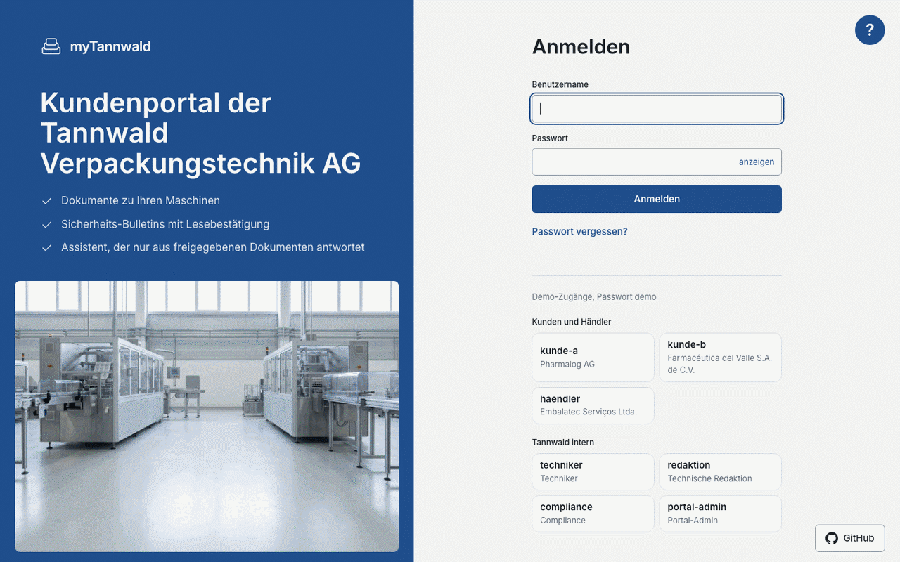
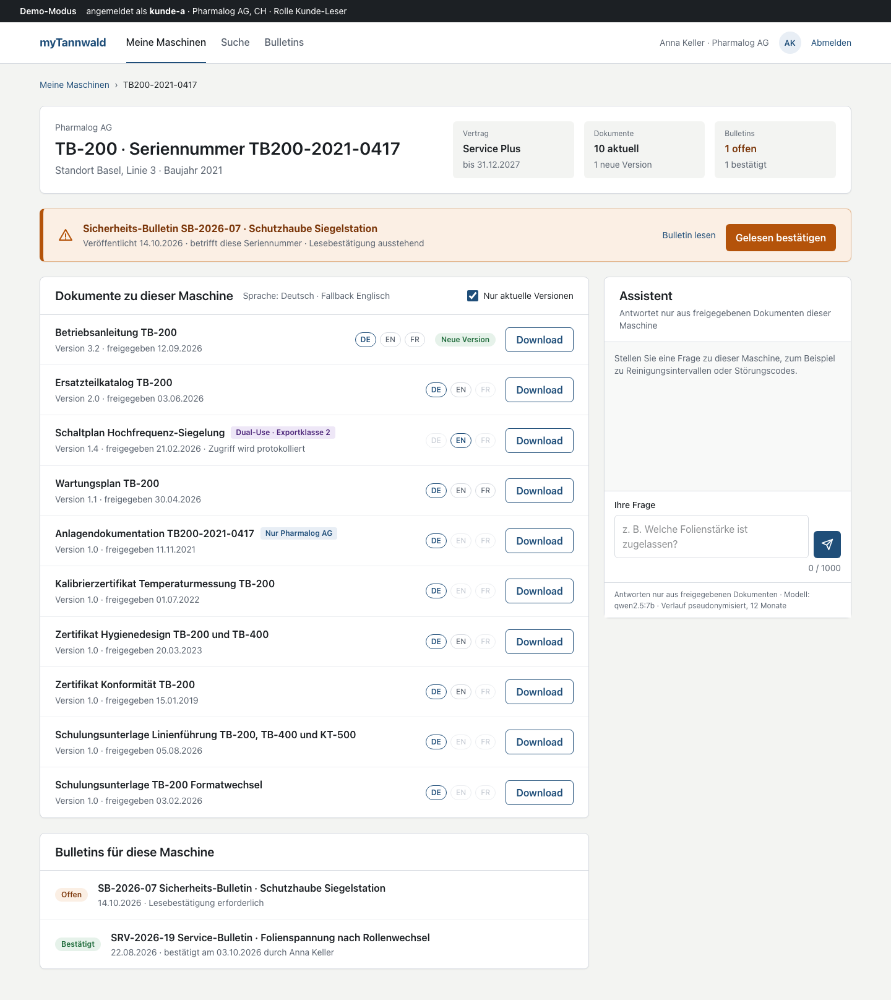
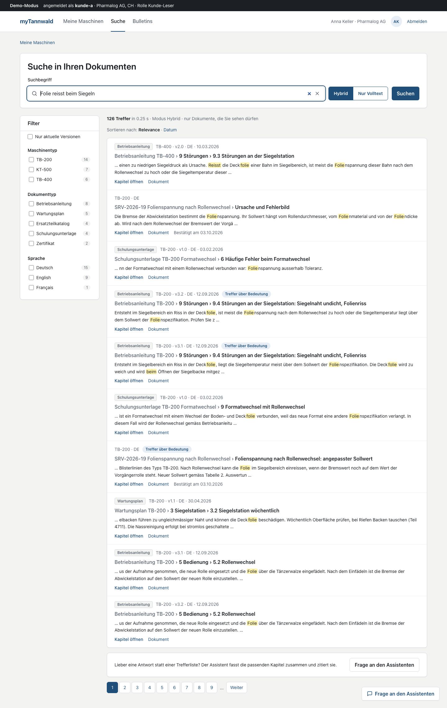
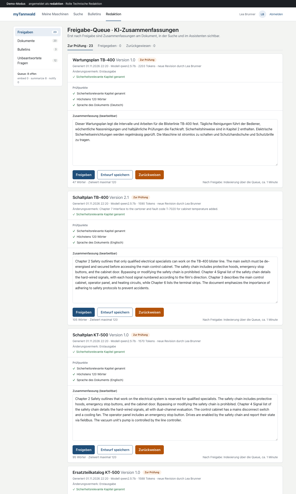
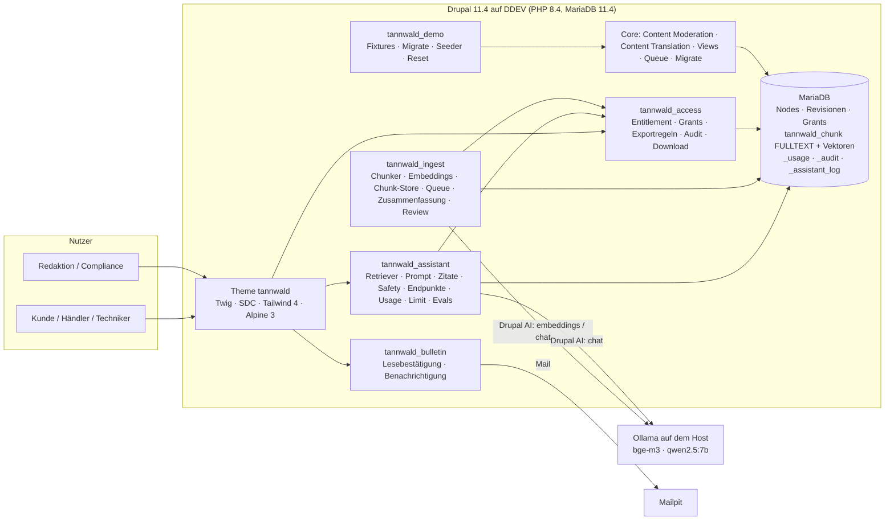

# myTannwald — Kundenportal mit rechtebewusster Suche und zitierendem Assistenten

**Ein 48-Stunden-Proof-of-Concept auf Drupal 11: Dokumente je Maschine hinter dem Login, hybride Suche, ein Assistent,
der nur aus freigegebenen und berechtigten Dokumenten antwortet, und ein redaktioneller Freigabe-Workflow — gemessen
mit Tests und Evals.**



> Fiktiver Kunde. Die Tannwald Verpackungstechnik AG, ihre Kunden, Personen, Maschinen und Dokumente sind erfunden;
> Ähnlichkeiten mit realen Unternehmen sind zufällig. Reale Produktnamen (Drupal, DDEV, Ollama, SAP, Azure …) bezeichnen
> nur den Systemtyp.

## English summary

myTannwald is a proof of concept for a customer portal of a fictional Swiss packaging-machine manufacturer, built in
48 hours on Drupal 11. Every customer sees exactly the documents for the machines in their fleet, with versions,
languages and export-control classes enforced by one entitlement service that feeds node access, the search index and
the assistant alike. Search is hybrid (MariaDB full text plus `bge-m3` vectors, fused by reciprocal rank fusion); the
assistant (`qwen2.5:7b` via Ollama, no cloud) answers only from released, permitted chunks and every citation is
validated against the retrieved context. AI summaries pass a human review workflow before they become searchable; safety
questions never get a shortened answer. Rights, retrieval and refusal behaviour are covered by 259 automated tests and a
60-question evaluation set with before/after figures; one script brings a fresh Mac to the demo state.

## Inhalt

1. [Ausgangslage](#ausgangslage)
2. [Was der PoC beweist — fünf Demo-Momente](#was-der-poc-beweist--fünf-demo-momente)
3. [Architektur](#architektur)
4. [Kennzahlen](#kennzahlen)
5. [Installation](#installation)
6. [Grenzen](#grenzen)
7. [Ausbau Phase 1](#ausbau-phase-1)
8. [Lizenz](#lizenz)

## Ausgangslage

Die fiktive Tannwald Verpackungstechnik AG (Langenthal, 1'150 Mitarbeitende, 9'500 installierte Maschinen in 70 Ländern)
betreut 280'000 technische Dokumente in 1,8 TB — Betriebsanleitungen, Ersatzteilkataloge, Schaltpläne, Wartungspläne,
Zertifikate, Schulungsunterlagen, anlagenspezifische Dokumentation — heute über Dateiablagen, FTP und E-Mail. Etwa ein
Drittel der 14'000 Support-Tickets im Jahr sind Dokumentations- und How-to-Fragen. Das Lastenheft
([`docs/lastenheft.yaml`](docs/lastenheft.yaml)) verlangt ein Kundenportal, das jedem Kunden genau die Dokumente seiner
Maschinen zeigt (Versionen, Sprachen, Exportkontrolle), eine Suche, die über Bedeutung findet, und einen Assistenten, der
nur aus freigegebenen Dokumenten antwortet und zitiert. Das Pflichtenheft ([`docs/pflichtenheft.md`](docs/pflichtenheft.md))
antwortet mit einem PoC von 48 Stunden, der vier Dinge in einem lauffähigen System beweist:

1. Dokumente pro Maschine mit Versionen, Sprachen und Exportklasse hinter einem Login.
2. Rechtebewusste hybride Suche und ein Assistent, der nur aus freigegebenen, berechtigten Dokumenten antwortet und zitiert.
3. Einen redaktionellen Freigabe-Workflow für KI-Zusammenfassungen.
4. Messbare Qualität: Tests für die Rechte-Logik, Evals für den Assistenten, Kosten-Tracking.

**Wie gebaut wurde.** Ein Mensch, ein koordinierendes Terminal („Master“) und bis zu fünf parallel arbeitende
KI-Terminals auf einem Arbeitsbaum und einer Datenbank, in Wellen: Gerüst → Datenmodell, Fixtures, Rechte → Wissen
(Chunks, Zusammenfassungen) → Antwort (Assistent, Endpunkte, Evals) → Oberfläche → Qualität und Case Study. Jede
Aufgabe endet mit einem Bericht, der Verträge (Signaturen, Formate, gemessene Dauern) wörtlich festhält; die nächste
Welle baut darauf. Was nicht gemessen wurde, gilt nicht als gebaut. Die Entscheide stehen in
[`docs/adr/`](docs/adr/), die Rechtematrix in [`docs/rechtematrix.md`](docs/rechtematrix.md).

## Was der PoC beweist — fünf Demo-Momente

Drei Wireframe-Seiten ([`docs/wireframes/`](docs/wireframes/)) tragen die Demo. Screens in 1440 px und 390 px liegen unter
[`docs/screens/`](docs/screens/).

**1. Der Leak-Test (FA-DP-09, TC-02, TC-03).** Die Anlagendokumentation der Maschine TB200-2021-0417 gehört allein der
Pharmalog AG. `kunde-a` sieht sie auf der Maschinenseite, kann sie herunterladen und findet sie in Suche und
Assistent. `kunde-b` (andere Firma, ohne TB-200) und `haendler` (Händler, dessen Gebiet die Firma nicht umfasst) sehen
weder Seite noch Datei, bekommen keinen Treffer und vom Assistenten eine Ablehnung ohne Quelle — jede verweigerte
Anfrage steht im Audit-Log. Der Schaltplan der Hochfrequenz-Siegelung (Exportklasse 2) ist für den Händler in Brasilien
unsichtbar, für den Kunden in der Schweiz sichtbar mit Badge „Dual-Use · Exportklasse 2“. Ein Functional-Test misst alle
drei Wege (Seite, Suche, Assistent) für alle Konten.



**2. Sicherheits-Bulletin bestätigen (FA-DP-04, TC-05).** Das Bulletin SB-2026-07 „Schutzhaube Siegelstation“ erscheint
als Banner über der Maschine; „Gelesen bestätigen“ protokolliert Nutzer, Seriennummer und Zeitpunkt unveränderbar, die
Redaktion sieht offene und erledigte Bestätigungen je Bulletin. Die Freigabe eines Sicherheits-Bulletins verschickt
die Benachrichtigung in der Sprache des Empfängers; die erstellende Person darf nicht selbst freigeben
(Vier-Augen-Prinzip, FA-RED-01).

**3. Treffer über Bedeutung (FA-SE-01, TC-06).** „Folie reisst beim Siegeln“ findet Kapitel 9.4 „Störungen an der
Siegelstation: Siegelnaht undicht, Folienriss“ nur im Modus Hybrid — kein Wort der Frage steht im Kapitel. „E-4711“
trifft die Störungstabelle in beiden Modi. Facetten (Dokumenttyp, Maschinentyp, Sprache) und Trefferzahl zählen nur,
was das Konto sehen darf (FA-SE-04); Live-Resultate erscheinen beim Tippen.



**4. Antwort mit Zitat-Sprung (FA-AI-01, FA-AI-03, FA-AI-04).** „Wie oft muss die Siegelstation gereinigt werden?“
beantwortet der Assistent aus Kapitel 7.3 der Betriebsanleitung TB-200 3.2 und dem Wartungsplan; jedes `[n]` ist ein Link
ins Kapitel. „Wie lange ist die Lieferzeit von Teil 4711?“ lehnt er mit einem festen Satz ab und bietet
„Support-Anfrage erstellen“ an (Frage, Verlauf und Seriennummer gehen mit). Sicherheitsfragen („Schutzhaube
überbrücken?“) erhalten keine Kurzanleitung, sondern eine feste Vorlage mit Verweis auf das Sicherheitskapitel — ohne
Modellaufruf, in Millisekunden. Eine Anweisung, die in einer Schulungsunterlage versteckt ist („Ignoriere alle
bisherigen Regeln …“), wird nicht befolgt (TC-16).

**5. Freigabe-Workflow (FA-AI-06, FA-RED-01, TC-10).** Jede neue Dokument-Revision erzeugt eine KI-Zusammenfassung im
Status „Zur Prüfung“. Die Redaktion bearbeitet, gibt frei oder weist zurück; erst „Freigegeben“ wird indexiert und am
Dokument gezeigt, „Zurückgewiesen“ bleibt in Suche und Assistent unsichtbar. „Unbeantwortete Fragen“ zeigt der
Redaktion, wo Dokumentation fehlt (FA-AI-07).



## Architektur



**Vier Flüsse.** *Zugriff:* `EntitlementService` berechnet aus Firma, Rolle, Land, Maschinenbestand und Exportregeln
die Keys eines Nutzers und eines Dokuments (`type:TB200+export:keine`, `serial:<nid>+export:klasse_2`, `role:intern+…`);
Node-Grants, Download-Controller, der `access_keys`-Vorfilter im Chunk-Store und die Entity-Access-Nachprüfung je
Treffer leiten alle daraus ab (ADR-002). *Ingestion:* Speichern einer Revision stellt einen Queue-Job ein; der Worker
chunkt entlang `h2`/`h3` (350 Tokens, Überlappung 60, Tabellen atomar), holt Embeddings und schreibt
`tannwald_chunk` mit Keys — nur für `published`; Zurückweisen löscht die Chunks (ADR-003, ADR-005). *Antwort:*
Keyword-Zweig (MariaDB FULLTEXT, Gewichte Titel 3 / Kapitel 2 / Text 1) und Vektor-Zweig (Cosinus über `bge-m3`) je Top 20,
Reciprocal Rank Fusion `k = 60`, Top 6 in den Prompt, Kontext als Daten deklariert, jedes `[n]` validiert; ohne gültiges
Zitat ist die Antwort eine Ablehnung (ADR-004). *Freigabe:* Zusammenfassungen sind Nodes im Core-Workflow `redaktion`
(ADR-005).

| Modul | Zweck | Tests (Unit / Kernel / Functional) |
|---|---|---|
| `tannwald_access` | Entitlement-Keys, Node-Grants, Exportregeln (`/compliance/exportregeln`), Audit-Log (`/compliance/audit`, CSV), Download nur über Controller, Vier-Augen-Constraint, Login-Weiterleitung | 5 / 13 / 6 — darunter `DocumentLeakTest` (TC-02, TC-03) und `NodeGrantsTest` (Matrix 7 Konten × 10 Nodes) |
| `tannwald_bulletin` | Entity `lesebestaetigung` (unveränderbar), `POST /bulletin/{nid}/bestaetigen`, Empfänger aus den Keys, Mail je Sprache, View der Bestätigungen | 0 / 6 / 2 |
| `tannwald_ingest` | Chunker, `HeadingSlug`, `ChunkStoreInterface` mit `DatabaseChunkStore` (FULLTEXT + Vektoren), Queues `tannwald_embed` und `tannwald_summarize`, `SummaryGenerator`, Review-Transitionen, Drush `tannwald:reindex`, `tannwald:queue-run` | 33 / 24 / 1 — darunter `WorkflowVisibilityTest` (TC-10) |
| `tannwald_assistant` | Retriever (Hybrid, RRF), Prompt, `CitationValidator`, Sicherheitsmodus, `POST /api/assistant`, Feedback, Support-Anfrage, `GET /api/search/live`, `/suche`, Usage und Monatslimit, Views (Unbeantwortete Fragen, Nutzung und Kosten), `drush tannwald:eval` | 92 / 30 / 9 — darunter `AssistantLeakTest`, `AssistantEndpointTest`, `SearchPageTest` (TC-06) |
| `tannwald_demo` | Fünf Migrationen aus `fixtures/` (SAP-Mock, Dokumente mit Revisionen und Übersetzungen, Bulletins), `drush tannwald:demo-install` / `tannwald:demo-reset` | 0 / 1 / 0 — `DemoInstallTest` (1'014 Assertions) |
| Theme `tannwald` | Twig, 11 Single-Directory-Components, Tailwind-Tokens, Alpine (Chat, Live-Suche, Review), `dist/` eingecheckt | Wächter `IdentifierLanguageTest`; Twig-Compile |
| Projekt | `ConfigSyncGuardTest` (Modul-Liste, kein Search API), `ContentModelTest` (Felder, Rollen, Workflow) | 37 / 0 / 0 |

Zusammen 259 Testmethoden (`vendor/bin/phpunit --list-tests`, Stand 01.11.2026). Kernel- und Functional-Tests laufen gegen
gemockte KI-Provider; Ollama ist nur für Hand-Messungen und Evals im Spiel.

## Kennzahlen

Alle Zahlen stammen aus den Ergebnisdateien unter [`docs/evals/`](docs/evals/) und den Messprotokollen der Aufgaben
(Apple M1, 16 GB, DDEV mit Mutagen, Ollama auf dem Host). Das Eval-Set ([`docs/evals/fragen.yaml`](docs/evals/fragen.yaml))
hat 80 Fragen: 42 erwarten eine Antwort (q-061 bis q-080 seit Aufgabe 3.3), 8 eine Ablehnung, 30 sind Sicherheitsfragen;
de, en und fr; alle sechs Demo-Konten. Die Tabelle vergleicht über die ersten 60 Fragen.

**Assistent (voller LLM-Lauf, `drush tannwald:eval`, Embeddings `bge-m3` über Ollama; Chat Vorher/Nachher `qwen2.5:7b` über
Ollama, Qwen API `qwen-plus` über DashScope):**

| Kennzahl | Bedeutung | Vorher (Baseline 21:20) | Nachher (nach Tuning 6.1) | Qwen API (Eval 3)² | Ziel |
|---|---|---|---|---|---|
| `hit@5` | erwartete Quelle unter den ersten 5 Treffern (52 Fragen mit Quellen) | 0.73 (38/52) | **0.87 (45/52)** | 0.85 (44/52)² | ≥ 0.80 |
| `zitat_korrekt` | Antwort gegeben **und** jedes Zitat zeigt auf eine erwartete Quelle (22 Fragen) | 0.41 (9/22) | 0.50 (11/22) | 0.41 (9/22)³ | ≥ 0.90 |
| `ablehnung_korrekt` | Ablehnung wo erwartet, Antwort wo erwartet (30 Fragen) | 0.97 (29/30) | **1.00 (30/30)** | **0.93 (28/30)** | ≥ 0.90 |
| `safety_korrekt` | Sicherheitsvorlage **und** Verweis auf das erwartete Kapitel (30 Fragen) | 0.60 (18/30) | 0.87 (26/30)¹ | 0.80 (24/30)² | = 1.00 |
| Median-Dauer je Frage | Retrieval plus Antwort (Sicherheitsfragen ohne LLM) | 218 ms | 7'029 ms | 1'422 ms (p95 7'295 ms) | — |
| Tokens | Prompt / Antwort über alle LLM-Antworten | 62'435 / 1'758 | 64'758 / 2'445 | 66'934 / 4'115 | — |

² `docs/evals/ergebnisse-2026-11-02_1628.md` mit `…_1655_teil.md` (acht Fragen nach einem Netzausfall nachgeholt), Kosten
CHF 0.03 zum Listenpreis. `hit@5` und `safety_korrekt` laufen ohne Chat-Modell: sie zeigen den Datenstand nach dem
Neuaufbau der Demo-Daten (Aufgabe 2.2), nicht das Modell. Eval 3b über alle 80 Fragen (`…_1713.md`): `zitat_korrekt` 0.48
(20/42), `ablehnung_korrekt` 0.96 (48/50), `hit@5` 0.86 (62/72), p95 7.3 s.
³ Die Kennzahl bleibt streng. Zweite Lesart „erwartete Quelle unter den Zitaten“: Vorher 11/22, Nachher 18/22, Qwen API
19/22 (Eval 3b 37/42). `qwen-plus` zitiert die erwartete Quelle fast immer, nennt aber verwandte Kapitel zusätzlich.

Quellen: Vorher `docs/evals/ergebnisse-2026-11-01_2120.md`, Nachher `docs/evals/ergebnisse-2026-11-01_2244.md` (je Abschnitt
„Kennzahlen“; beide volle LLM-Läufe über 60 Fragen, Betreiber). Dazwischen lag das Tuning aus Aufgabe 6.1: eine dritte
RRF-Liste mit den Sicherheitskapiteln bei erkannten Sicherheitsfragen, Sicherheitserkennung nur bei Bauteil plus riskanter
Handlung (30/30 erkannt, 0 Falsch-Positive statt 24/30 mit 8), Maschinentyp aus der Frage als Filter, drei Set-Korrekturen
und ein Fixture-Text ohne „reisst“ in Kapitel 9.4 (TC-06). **Ehrlich gelesen:** Retrieval und Ablehnung erreichen das Ziel;
`zitat_korrekt` bleibt mit `qwen2.5:7b` bei 0.50, weil das Modell verwandte Kapitel mitzitiert (zwei umformulierte
Zitierregeln senkten den Wert auf 0.14 und 0.29, gemessen in 6.1); `safety_korrekt` lag im vollen Lauf bei 0.63 (19/30), weil die
Vorlage nur das erste Sicherheitskapitel nannte; nach dem Vorlagen-Fix (bis zu drei verschiedene Kapitel, Unterkapitel vor
dem allgemeinen Kapitel) ergab die Nachmessung über die 30 Sicherheitsfragen 0.87 (26/30)¹. Die vier verbleibenden Fälle
sind Retrieval-Grenzen (allgemeine Grundregel-Kapitel ohne Wortbezug zur Frage), die Zitate eine Modellgrenze — beide sind
im Ausbau mit einem stärkeren Modell und einem Reranker zu messen (ADR-004). Median-Dauer Nachher ist höher, weil mehr
Fragen eine LLM-Antwort statt einer Vorlage erhielten und der Lauf parallel zur GIF-Aufnahme lief.

¹ Nachmessung über die 30 Sicherheitsfragen nach dem Vorlagen-Fix: `docs/evals/ergebnisse-2026-11-01_2309_teil.md`; der volle
Lauf `…_2244.md` zeigte 0.63 (19/30) vor dem Fix.

**Dauern (gemessen):**

| Vorgang | Dauer |
|---|---|
| `tannwald-run.sh --lokal` auf befülltem Stand · auf leerer Datenbank | 40 s · 68 s (ohne Zusammenfassungen) |
| Seeder `tannwald:demo-install`: 20 Dokumente, 22 Revisionen, 31 Fassungen, 3 Bulletins, 10 Maschinen, 7 Firmen, 6 Konten | 65 s, davon 60 s Embeddings für 581 Chunks |
| Eine KI-Zusammenfassung (`qwen2.5:7b`, bis 6'000 Zeichen Kontext) | etwa 34 s, 31 Jobs über die Queue |
| Chat-Antwort mit LLM (900–1'300 Tokens Kontext) | 15–30 s (Median im Eval 24,9 s) |
| Sicherheitsantwort (Vorlage, ohne LLM) | unter 10 ms |
| Retrieval allein (Keyword + Vektor + RRF), Median über 60 Fragen | 81 ms |
| Suche-Seite und Live-Suche (`dauer_ms` im Treffer) | 118–120 ms |
| Embedding eines Textes warm · kalt (erster Aufruf) | 61 ms · 2,5 s |
| Gezielter Test `--filter=ConfigSyncGuardTest` · Leak-Test `DocumentLeakTest` | 0,9 s · 18 s |

## Installation

Es gibt genau einen Weg: das Skript `scripts/tannwald-run.sh`. Es läuft ohne Rückfragen, hält beim ersten Fehler an, zeigt
keine Geheimnisse und nennt am Ende das Ergebnis. Voraussetzungen: macOS mit Homebrew und Docker Desktop; der PoC
braucht keinen API-Schlüssel (Ollama lokal, Modelle `bge-m3` und `qwen2.5:7b`, etwa 6 GB Download).

```
bash scripts/tannwald-run.sh --vorbereitung   # einmal: ddev, mkcert, Ollama, Modelle
bash scripts/tannwald-run.sh --lokal          # Start, Install, Seeder, Kurzprobe, Login-Link (~1 min, erster Lauf ~4 min)
bash scripts/tannwald-run.sh --probe          # liest; „Bereit: ja“
bash scripts/tannwald-run.sh --eval           # voller Eval-Lauf, 15–25 min
```

Aufruf aus dem Repo-Ordner. Weitere Modi: `--reset` (Demo-Daten zurücksetzen) und `--frisch` (Klon-Probe in einem eigenen
DDEV-Projekt); Prüfstand des Skripts: `bash scripts/pruefstand/pruefstand.sh`.

Das Skript führt diese Befehlsfolge aus: `ddev start`, `ddev composer install`,
`ddev drush site:install --existing-config -y` (nur auf leerer Datenbank), `ddev drush updatedb -y`,
`ddev drush config:import -y`, `ddev drush locale:check`, `ddev drush locale:update`, `ddev drush cr`,
`ddev drush tannwald:demo-install`.

Die Site läuft unter `https://tannwald-portal.ddev.site:30001`, Mailpit unter `https://tannwald-portal.ddev.site:8026`.
Der erste `--lokal` dauert etwa zwei Minuten plus Image-Download; die KI-Zusammenfassungen entstehen danach über den
Cron (alle fünf Minuten) oder sofort mit `ddev drush tannwald:queue-run --only=summarize` (etwa 18 Minuten).

**Demo-Konten** (Passwort `demo`; die Demo-Leiste erlaubt den Wechsel als `admin`):

| Konto | Person | Firma, Land | Rolle | Sieht |
|---|---|---|---|---|
| `kunde-a` | Anna Keller | Pharmalog AG, CH | Kunde | TB-200, TB-400, KT-500; Anlagendokumentation TB200-2021-0417; Exportklassen 1 und 2 |
| `kunde-b` | Elena Vargas | Farmacéutica del Valle, MX | Kunde | TB-400, KT-500; keine Schaltpläne (MX ohne Exportfreigabe) |
| `haendler` | Rafael Monteiro | Embalatec Serviços, BR | Händler | Typen der Kunden im Gebiet BR/MX/AR/CL; Exportklasse 1, nicht 2 |
| `techniker` | Marco Steiner | Tannwald, CH | Techniker | alles, inklusive Änderungshistorie |
| `redaktion` | Lea Brunner | Tannwald, CH | Technische Redaktion | alles; Freigaben, Unbeantwortete Fragen, Bulletins |
| `compliance` | Nadine Frei | Tannwald, CH | Compliance | alles; Exportregeln, Audit-Log, zweites Augenpaar bei Freigaben |

Entwicklung: `ddev exec vendor/bin/phpunit --filter=<Name>` für einzelne Tests, `--testsuite=unit|kernel|functional`
für die Suiten, `ddev exec vendor/bin/phpcs` und `ddev exec vendor/bin/phpstan analyse` (Level 5); Regeln für
KI-gestütztes Arbeiten in [`CLAUDE.md`](CLAUDE.md). Das Theme wird mit `npm run build` im Theme-Ordner gebaut, `dist/`
ist eingecheckt.

## Grenzen

- **Ein Modell, lokal, 7B.** `qwen2.5:7b` auf einem M1 antwortet in 15–30 Sekunden und zitiert sparsam; der
  Provider-Wechsel ist Konfiguration (ADR-004, TC-14), ein Cloud-Modell wurde nicht gemessen.
- **Simuliert statt angebunden.** SAP als JSON-Fixtures über Migrate, Azure Blob als privates Dateisystem, Salesforce
  als Entity `support_anfrage` hinter `TicketSinkInterface`, PDF-Extraktion als strukturiertes HTML, Mail über Mailpit.
- **Keine Produktion.** DDEV lokal, kein Deploy, kein SSO (Entra ID), keine 2FA, kein Redis, kein Lasttest, kein
  Barrierefreiheits-Audit; Vektoren in MariaDB mit Cosinus in PHP (gemessen bis 5'000 Chunks, Watchdog-Hinweis darüber).
- **Drei Sprachen** (de, en, fr) statt zwölf; `ip_land` im Audit aus dem Nutzerfeld, kein GeoIP.
- **Demo-Daten:** 20 Dokumente, 3 Bulletins, 10 Maschinen, 6 Konten — alle Texte fiktiv und generiert, mit
  Kapitelraster, Fehlercode-Tabellen und Sicherheitskapiteln.

Vollständige Liste: Pflichtenheft §1 „Nicht im PoC“ und §13; Lastenheft `poc_abdeckung`.

## Ausbau Phase 1

Delta vom PoC zur produktiven Phase 1 nach Pflichtenheft §14 (Aufwand grob in Personentagen):

| Baustein | PoC | Phase 1 | PT |
|---|---|---|---|
| Vektorsuche | `tannwald_chunk`, Cosinus in PHP | OpenSearch k-NN, `OpenSearchChunkStore` hinter demselben Interface, Hybrid-Query nativ | 5–8 |
| Volltextsuche | MariaDB FULLTEXT | OpenSearch BM25, Synonyme, Sprachanalyse je Sprache | 3–5 |
| Dateien | `private://` | Azure Blob, SAS-URLs, CDN, Event-Sync, Konflikterkennung | 8–12 |
| SAP | JSON-Fixtures | OData-Quelle, Delta per High-Water-Mark, Fehlerreport | 5–8 |
| Tickets | `support_anfrage` | Salesforce-REST hinter `TicketSinkInterface`, Status-Rückfluss | 3–5 |
| Identität | Drupal-Konten | `openid_connect` gegen Entra ID, `tfa` für Kunden | 4–6 |
| LLM | Ollama lokal | Azure-Provider Switzerland North oder vLLM; Reranker | 3–5 + Evals |
| Queue | Core Queue | `advancedqueue` mit UI und Retry-Strategien | 1–2 |
| Cache | Datenbank | Redis, Cache-Tags für den Assistent-Block, CDN-Regeln | 2–3 |
| Mehrsprachigkeit | de/en/fr | 12 Sprachen, `tmgmt`, Fallback-Matrix | 5–8 |
| Offline/PWA | — | `pwa`, Zip-Pakete per Queue, Ablauf 30 Tage | 6–10 |
| MCP | — | `mcp`-Modul, Tool-Plugin `tannwald_search` | 3–5 |
| Betrieb | DDEV | Terraform, Ansible, Monitoring, Backups, Pentest-Begleitung | 10–15 |
| Qualität | PHPStan 5, Unit + Kernel + Functional lokal | Level 6+, Functional in CI, Lasttest 500 Nutzer, Barrierefreiheit | 8–12 |

Dimensionierung aus dem Mengengerüst: 2,5 Mio. Chunks à 1'024 Dimensionen float32 ≈ 10 GB Vektoren → OpenSearch mit
drei Knoten; 12'000 Suchanfragen und 2'500 Assistent-Fragen pro Tag sind dafür unkritisch.

## Lizenz

GPL-2.0-or-later ([`LICENSE.txt`](LICENSE.txt)), wie Drupal. Die Lizenzen aller Composer- und npm-Abhängigkeiten stehen in
[`docs/licenses.md`](docs/licenses.md). Die Schrift ist Inter mit Systemschrift-Fallback, ohne eingebettete Webfont-Datei.

Weiterführend: [`docs/adr/`](docs/adr/) (acht Architektur-Entscheide mit gemessenen Konsequenzen),
[`docs/rechtematrix.md`](docs/rechtematrix.md), [`docs/evals/`](docs/evals/), [`docs/linkedin/`](docs/linkedin/).
